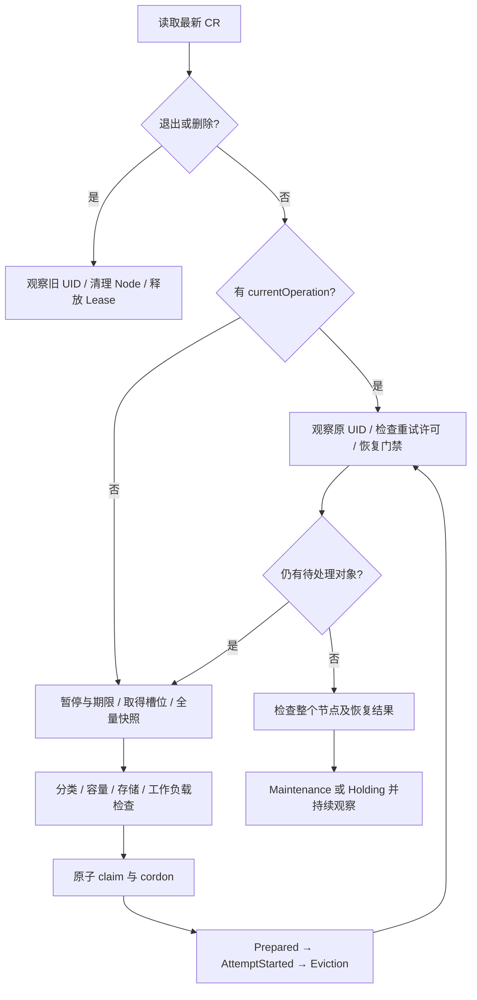

# 设计与不变量

## 边界

一项 NodeMaintenance 绑定一个 Node UID。所有 Execute 任务共享持久 Lease 槽位，直至维护退出；manager leader election 解决多副本进程竞争，Lease 解决不同任务竞争。二者都不宣称严格 fencing 或 exactly once。

外部重启、升级、维修由运维流程执行。SmartDrain 负责隔离、驱逐、观察与恢复调度状态；不调整业务副本、不修改 PDB、不删除 PVC、不注入 NoExecute taint，也不自动将增强策略降级成兼容策略。

## 不变量

1. 每次删除请求绑定原 Pod UID；同名新 Pod 只作为恢复观察对象。
2. 删除前持久化 AttemptStarted，并重新直读任务意图、Lease 和 Node claim。
3. 未确认请求执行结果时保留 sticky Unknown，后续 429/403 不能消除历史不确定性。
4. 旧 UID 消失与工作负载恢复是两个检查；退出只等待前者及本任务的 pendingCleanup。
5. Node claim 和 cordon 在一次带 resourceVersion 的 patch 中写入，保存 originalUnschedulable。
6. Node 清理留下 cleanupApplied 凭据，再确认 status、删除自有 claim、释放槽、移除 finalizer。
7. 暂停和超时停止新删除，观察与退出继续。超时不自动 uncordon。
8. 全量扫描所有 namespace，不以恢复模型的 Kind 列表限制兼容模式驱逐资格。

## 协调顺序

所有等待通过 Watch 与 RequeueAfter 推进。关键读取使用直连 APIReader；跨 Node、Pod、PVC、控制器的读取并不是事务快照，因此最终仍须观察真实恢复结果。

## Node 准备窗口

NodeClaimStarted 和准备时 Node resourceVersion 先写入 status，再执行原子 claim patch。若进程在准备后崩溃，重启读到相同 Node 版本可证明 patch 尚未生效；若 claim 已存在，则依靠 claim 恢复原始状态。版本已变化且 claim 不存在时，无法区分尚未提交与外部删除凭据，保留 ClaimOutcomeUnknown，交由运行手册处理。

这份保守协议允许不确定情况下停止推进，不用“当前节点已 cordon”猜测原始值。成功响应丢失、状态冲突和清理重放由专门故障测试覆盖。

## 恢复与存储

冻结控制器 UID、generation、desired、模板摘要；Deployment 另存活动 RS UID，StatefulSet 另存 revision 和 ordinal 区间。Pod 模板匹配按声明字段与命名列表检查，允许未声明的准入默认值和附加字段；声明字段被改变则阻塞。健康计数要求归属正确、非终止、Ready、Node Ready，控制器 availableReplicas 达标。

窗口取 max(minReadySeconds, 10s)。每轮观察全部基线；任一副本不健康、UID/重启指纹变化或进程重启，相关窗口重新计时。StatefulSet 还必须找到同 ordinal 的新 UID、原 revision、源节点之外的位置及相同 PVC/PV 绑定。

所有卷约束与计算候选取交集。NFS CSI 的 RWX/Filesystem、绑定身份、attachRequired=false、节点注册和 PV affinity 属于已实现模型。其他 CSI、local、hostPath 等仍可在 DrainCompatible 下驱逐，增强结论明确为 Unknown；本地卷实验展示了这种情况下真实 Pending 的替代 Pod。

## 容量模型

使用固定版本 component-helpers 的有效 PodRequests，包括普通容器、init、restartable init sidecar 和 overhead。扣减全 namespace 已绑定非终态 Pod、保守保留 terminating 请求，另扣 Pod 槽位。候选须满足 Ready、可调度、nodeSelector、required node affinity、taint/toleration 与卷约束。

确定性 first-fit 为每次虚拟放置扣减预算。首个目标在全部已知候选均无法放置时可报告 Blocked；后续贪心失败不能证明无解，报告 Unknown。相关硬反亲和、待调度竞争或未建模资源/约束会使相关候选不确定；无关 namespace、标签和拓扑约束不一概阻止模型。

硬 Pod affinity、hard spread、hostPort、扩展资源、DRA、ephemeral-storage、hugepages、Pod-level resources、resize、未知 scheduler 等未实现调度模拟。容量预检不替代 scheduler，不预留资源，不预测重复准入产生的变化。

## 有界状态

当前 Pod 报告、工作负载基线、Job 观察和 pendingCleanup 各限制 256 条；超过时停止新动作并报告容量问题。详细历史放结构化日志和实验文件。指标只使用 phase、action、outcome 等有限标签；任务完成时清除内存健康窗口。
